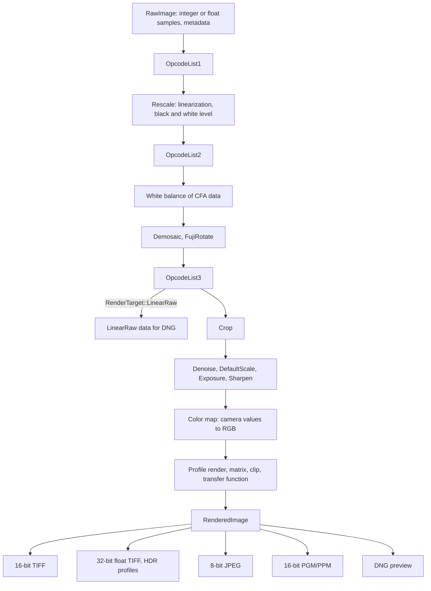

# Rendering raw images

This document describes how rawler turns the image data of a raw file into a
final image: a 16-bit TIFF, a 32-bit floating point TIFF for High Dynamic Range
profiles, a JPEG, a 16-bit PGM/PPM, or the LinearRaw data and preview of a DNG
file.

The rendering lives in [`rawler/src/imgop/render/`](../rawler/src/imgop/render/).
It is split into two parts:

- **[`plan`](../rawler/src/imgop/render/plan.rs)** decides which operations are
  applied, in which order and with which parameters. It only reads the metadata
  of the raw image and the `RenderOptions`. The one exception is the estimate of
  a missing white balance, which reads the image data.
- **[`execute`](../rawler/src/imgop/render/exec.rs)** applies the operations of a
  `Plan` to the image data. The operations are public functions that work on
  borrowed image data, for example `camera_to_rgb` or `wavelet_denoise`, so they
  can also be used on their own.

`render(rawimage, &options)` does both. A `Plan` implements `Debug`: printing it
with `{:#?}` shows every operation and its parameters (see the `full_render`
example).

## Entry points

| Caller | Function | Result |
| --- | --- | --- |
| `dnglab process-raw` | `process_raw_image` in [`develop.rs`](../rawler/src/imgop/develop.rs) | TIFF, JPEG or PGM/PPM file |
| Library | `RawDevelop::develop`, `develop_jpeg`, `develop_pnm`, `develop_image` | TIFF, JPEG, PGM/PPM, `RenderedImage` |
| Library | `render`, or `plan` and `execute` | `RenderedImage` |
| `dnglab convert` | `render_linear_raw` in [`convert.rs`](../rawler/src/dng/convert.rs) | LinearRaw data of the DNG |
| `dnglab convert` | `render` with the preview options | Preview and thumbnail of the DNG |

The examples [`simple_render`](../rawler/examples/simple_render.rs) (default
options) and [`full_render`](../rawler/examples/full_render.rs) (every option
spelled out, `plan` and `execute` called separately) show the library use.

`process-raw` builds the options in this order: command line, then
`RawProcessingParams`, then `RawDevelop`, then `RenderOptions`. Before rendering
it removes DNG opcodes (`--remove-dng-opcodes`), inserts the opcodes of
`replace_dng_opcodes` (the FixBadPixelsList of `--bad-pixels`) and replaces the
primary camera profile with a DCP (`--dcp-file`). With `--crop-transparent` it
also crops to the largest opaque area of the transparency mask.

## Options

`RenderOptions` ([`render/mod.rs`](../rawler/src/imgop/render/mod.rs)):

| Field | Default | Meaning | process-raw |
| --- | --- | --- | --- |
| `target` | `Image` | `Image`, or `LinearRaw` for the stage 3 data of a DNG | – |
| `steps` | all | Set of processing steps (`StepSet`) | `--steps`, `--skip-steps`, `--crop` |
| `white_balance` | `BeforeDemosaic` | Where the white balance is applied | – |
| `demosaic` | `Quality` | `Quality`, `Fast` or `Preview` (half size) | – |
| `bayer_demosaic` | `Ppg` | Algorithm for Bayer RGB data at `Quality`: `Ppg`, `Ahd`, `Vng`, `Rcd` or `Bilinear` | `--bayer-demosaic` |
| `xtrans_demosaic` | `Markesteijn` | Algorithm for X-Trans data at `Quality`: `Markesteijn` or `Vng` | `--xtrans-demosaic` |
| `color_space` | sRGB | Output primaries and transfer function: sRGB, Adobe RGB, ProPhoto RGB | `--color-space` |
| `denoise` | luma and chroma strength | Strength of the noise reduction | `--denoise-luma`, `--denoise-chroma` |
| `sharpen` | `DEFAULT_SHARPEN` | Strength of the sharpening | `--sharpen` |
| `exposure` | 0 EV | Manual exposure change | `--exposure` |
| `auto_exposure` | off | Correct the exposure by an estimate | `--auto-exposure` |
| `highlights` | `Compress` | Values above white after a positive BaselineExposure: compress or clip | `--highlights` |
| `extended_range` | off | The output can hold values above white (set by the TIFF writer) | automatic |

The processing steps (`ProcessingStep`) can be switched off one by one. A step
that is not in the set is skipped, which is useful to look at intermediate
results, for example `--skip-steps tonecurve,transferfunction` for linear data.
In `--steps` and `--skip-steps`, `all` stands for all steps.

Without the `Rescale` step, the values stay those of the raw data
([raw values](#raw-values)). `--skip-steps all` gives the whole raw image as it
is read from the file. Steps that don't expect
linear reference values, such as `Demosaic` and the crops, still give useful
raw values. `WhiteBalance` and `Calibrate` clip at 1.0.

| Step | Effect |
| --- | --- |
| `OpcodeList1` | Apply OpcodeList1 to the raw data as read from the file |
| `Rescale` | Map raw values to linear values 0.0 to 1.0 |
| `OpcodeList2` | Apply OpcodeList2 after `Rescale` |
| `Demosaic` | Demosaic CFA data |
| `OpcodeList3` | Apply OpcodeList3 after `Demosaic`, not for LinearRaw data |
| `FujiRotate` | Rotate images of sensors with a 45° layout |
| `CropActiveArea` | Crop to the ActiveArea |
| `BaselineExposure` | Apply BaselineExposure and BaselineExposureOffset |
| `WhiteBalance` | Apply the white balance |
| `AutoWhiteBalance` | Estimate a missing white balance from the image data, instead of D65 |
| `Calibrate` | Map camera values to the output color space |
| `ProfileRender` | Apply the rendering tables of the camera profile |
| `ToneCurve` | Apply the default tone curve (a profile tone curve replaces it) |
| `CropDefault` | Crop to the DefaultCrop |
| `Denoise` | Wavelet noise reduction |
| `DefaultScale` | Scale to square pixels (DefaultScale, BestQualityScale) |
| `Exposure` | Manual exposure change |
| `AutoExposure` | Estimated exposure change |
| `Sharpen` | Laplacian sharpening |
| `TransferFunction` | Encode the values by the transfer function of the output space |

`--crop best` keeps all steps. `activearea` removes `CropDefault`, and `none`
also removes `CropActiveArea`.

## Design rules

- **Scene-referred first.** Operations on the image, such as noise reduction,
  exposure and sharpening, run on linear, scene-referred values. They come
  before the color map, the tone curve and the transfer function, so they don't
  depend on the output color space. New image operations follow this rule.
- **One pass for color.** The map of camera values to RGB and everything after
  it (profile tables, matrices, clip, transfer function) is a list of per-pixel
  operations (`PixelOp`). It runs in one pass over the image.
- **Values stay linear and unclipped** as long as possible. Clipping happens
  only where it is defined: at the camera white, inside the profile render of SDR
  profiles, before the transfer function, and in the conversion to integers.
- **Positions are relative to the stage 3 image.** The gain table map and the
  semantic masks refer to the ActiveArea field of view. The executor tracks that
  area through crops and scaling, so each pixel operation gets its relative
  position (`u`, `v`).

## The plan, step by step

The planner makes these decisions first:

- **CFA layout and demosaic algorithm:**

  | Sensor | `Quality` | `Fast` | `Preview` |
  | --- | --- | --- | --- |
  | Bayer RGB | `bayer_demosaic`: PPG, AHD, VNG, RCD or bilinear | PPG | Superpixel, half size |
  | Bayer with 4 colors (CYGM, RGBE) | VNG, 4 planes | Bilinear, 4 planes | Superpixel, half size, 4 planes |
  | X-Trans | `xtrans_demosaic`: Markesteijn (3 passes) or VNG | Bilinear | Bilinear |

  The LinearRaw data of a DNG conversion (`render_linear_raw` with the default
  options) is demosaiced at `Quality` too.

  Images of rotated sensors (Fujifilm) are demosaiced with `Fast` instead of
  `Preview`, because they are rotated at full size.
- **White balance:**
  - It is the as-shot white balance. Without one, it is estimated from the image
    data (`AutoWhiteBalance`, see [`balance.rs`](../rawler/src/imgop/balance.rs)),
    or it is the white balance for D65 light from the color matrix.
  - The coefficients are normalized to a smallest coefficient of 1.0, like the
    camera neutral of DNG readers. White balanced values are limited to 1.0, the
    camera white, so clipped highlights stay neutral.
- **Exposure gain:** the exposure is BaselineExposure plus the profile's
  BaselineExposureOffset. A positive exposure is a linear gain of `2^exposure`
  in the color map. A negative exposure is a tone curve that keeps white at 1.0.
- **Calibration slot:** the slot of the as-shot camera profile that best matches
  D65. It gives the matrices and the hue/saturation map.

Then it pushes the operations below. Most are conditional, and a plan for a
DNG-like image without opcodes is short, for example
`RescaleMosaic, Demosaic, Denoise, Sharpen, CameraToRgb`.

### 1. OpcodeList1

The `OpcodeList1` step applies it to the image data as read from the file,
before anything else.

`--bad-pixels` gives a bad pixel list in the format of dcraw. dnglab turns it
into a FixBadPixelsList for each input file and inserts it at the start of
OpcodeList1, replacing an existing FixBadPixelsList:
- the coordinates are shifted from the ActiveArea to the raw image;
- pixels that died after the capture time are skipped.

### 2. Rescale and OpcodeList2

- The LinearizationTable is applied first.
- Then the black level of the pattern is subtracted and the result is divided by
  the white level minus the black level. The values are floats from 0.0 to 1.0
  after this step.
- For CFA data without LinearizationTable and without an OpcodeList1 or
  OpcodeList2 that is applied, the rescale and the white balance run in one
  pass (`RescaleMosaic`). Otherwise `Rescale` runs, followed by OpcodeList2
  with the `OpcodeList2` step.

### 3. White balance of CFA data

- With `WhiteBalancePlacement::BeforeDemosaic`, the default, CFA data is white
  balanced before the demosaic.
- The demosaic algorithms interpolate color differences, and those work better
  on white balanced data. Clipped highlights also stay neutral.
- The balanced values are clipped at 1.0, the camera white.
- With `AfterDemosaic`, the color map applies the white balance instead, as the
  DNG specification describes it.

### 4. Demosaic, FujiRotate and OpcodeList3

- CFA data is demosaiced and cropped to the ActiveArea. An algorithm returns
  a `RawlerError::InvalidInput` error for data it can't process, e.g. a CFA of
  another layout; the planner only picks algorithms that match the CFA. A CFA
  without an algorithm, e.g. a 2x8 pattern, makes the plan fail with the same
  error.
- **Tiled algorithms:** AHD, VNG, RCD and Markesteijn interpolate from a
  neighbourhood of pixels. They process the image in tiles in parallel, see
  [`sensor/tiles.rs`](../rawler/src/imgop/sensor/tiles.rs): each tile reads its
  core and a halo of pixels around it, and writes only its core. The halo covers
  the reach of the algorithm (5 pixels for AHD, 2 for VNG, 10 for RCD), so the
  result doesn't depend on the tiling. The tiles cover the image except a band
  of the width of the halo at the edges, which is interpolated bilinearly from
  the 3x3 neighbourhood ([`sensor/border.rs`](../rawler/src/imgop/sensor/border.rs)
  for AHD, VNG and RCD).
- **Partial demosaic:** without operations on the whole stage 3 image (no
  applied OpcodeList3 and no Fuji rotation), only the DefaultCrop is
  demosaiced, plus a margin of 32 pixels for the interpolation.
- **Fuji rotation:** Fujifilm images with a 45° sensor layout are rotated after
  the demosaic.
- **OpcodeList3** is applied after the demosaic by the `OpcodeList3` step, for
  example WarpRectilinear and GainMap.

**`RenderTarget::LinearRaw` ends here.** The white balance of the demosaic is
divided out again, without clipping, because DNG readers apply it themselves.
`dnglab convert` uses this to write LinearRaw DNGs (see
[Output](#dng-files)).

### 5. Crop

Crop to the DefaultCrop, or to the ActiveArea without one, unless the demosaic
did it already. Cropping before the color operations saves their work for the
cropped pixels.

### 6. Image operations on linear values

These run only on demosaiced data. Output-referred data (see
[below](#output-referred-data)) is already rendered and skips the noise
reduction, the sharpening and the automatic exposure.

- **Denoise** ([`denoise.rs`](../rawler/src/imgop/denoise.rs)): wavelet noise
  reduction of a luma and several chroma planes, on values stabilized by their
  square root. It runs before scaling, because scaling changes the noise.
- **DefaultScale**: scale to square pixels and to the best-quality size.
- **Exposure** ([`exposure.rs`](../rawler/src/imgop/exposure.rs)): the manual
  exposure, plus the estimate of `--auto-exposure`. All planes of a pixel get the
  same factor, so the chromaticity stays. A negative exposure follows a curve
  that keeps white at 1.0.
- **Sharpen** ([`sharpen.rs`](../rawler/src/imgop/sharpen.rs)): a Laplacian
  filter on the stabilized luma that fades out near black and white.

The white balance and the gain are not applied to the data yet. These
operations get them as a `scale`, to see neutral colors with a white of 1.0.

### 7. Color: from camera values to RGB

The `CameraToRgb` operation ([`color.rs`](../rawler/src/imgop/color.rs)) runs
these steps for each pixel:

1. Multiply by the white balance and the exposure gain, and clip at the camera
   white (`gain`). CFA data that was white balanced before the demosaic only gets
   the gain.
2. Apply the matrix from `camera_to_output`:
   - It includes AnalogBalance and CameraCalibration.
   - With a ForwardMatrix, the camera values go to XYZ D50 as DNG defines it, and
     are adapted to D65 by Bradford.
   - Otherwise the ColorMatrix, adapted to D65, is normalized so the camera
     neutral maps to white.
3. Apply the pixel operations:

   **With a camera profile render** (`ProfileRender`, see
   [`profile_render/`](../rawler/src/dng/profile_render/)), the matrix maps to
   linear ProPhoto RGB (D50) and the profile render runs there. Its tables are
   applied in this order:

   1. Limit to the white point (`gain`).
   2. ProfileHueSatMap of the calibration slot. It is applied before the
      exposure, to the values divided by the gain.
   3. The gain table map (ProfileGainTableMap2 or ProfileGainTableMap). Its input
      includes the BaselineExposure.
   4. **Values above white:**
      - SDR profiles clip at 1.0. With `--highlights compress`, the default, a
        hue-preserving shoulder (`HighlightShoulder`,
        [`highlights.rs`](../rawler/src/imgop/highlights.rs)) instead compresses
        the range from 0.75 up to the white point into 0.75 to 1.0.
      - HDR profiles keep their values above 1.0.
   5. ProfileLookTable.
   6. Tone curve: the ProfileToneCurve, or the default curve if the profile has
      none. A negative BaselineExposure is part of the curve. The curve is applied
      hue-preserving: the largest and smallest channel are mapped, and the middle
      one keeps its relative position.
   7. RGBTables: 3D lookup tables, weighted by the semantic mask at the pixel's
      position (see [`rgb_tables.rs`](../rawler/src/dng/profile_render/rgb_tables.rs)).
   8. Matrix from ProPhoto RGB to the output space.

   **Without rendering tables**, for example with `--skip-steps tonecurve` and a
   profile without tables, the matrix maps directly to the output space. The
   highlight shoulder then runs before the clip.

   Finally, `Clip` to 0.0 to 1.0 and the `TransferFunction` of the output space
   encode the values. Both are skipped:
   - without the TransferFunction step, which gives linear output;
   - for HDR output (see [Values above white](#values-above-white)).

The default tone curve ([`tone_curve.rs`](../rawler/src/dng/profile_render/tone_curve.rs))
is an S-curve fitted to the tone maps of camera JPEGs. It adds contrast around a
fixed point and keeps the brightness. Output-referred data doesn't get it.

### 8. Without the Calibrate step

Monochrome images, and color images with `--skip-steps calibrate`, skip the
color map and get these operations, each where it applies:

1. White balance, clipped at 1.0
2. Gain
3. Tone curve
4. Transfer function

## Values above white

There are three sources of values above 1.0:

- a positive BaselineExposure, applied as a linear gain;
- matrices, for saturated colors;
- High Dynamic Range camera profiles (`ProfileDynamicRange` = 1).

They are handled as follows:

- **The camera white** clips white-balanced camera values. Fully clipped pixels
  are white, not magenta.
- **SDR profiles** are defined on 0.0 to 1.0:
  - With `--highlights compress`, the default, the shoulder keeps the hue and
    the gradation of the range up to the white point.
  - `--highlights clip` clips each channel instead, like DNG readers.
- **HDR profiles** apply their tables and curve to values encoded by
  `encode_overrange`, which maps 0.0 to 16.0 into 0.0 to 1.0. The tone curve
  continues with its end slope above 1.0. The rendering keeps the values above
  1.0:
  - If the output can hold them (`RenderOptions::extended_range`, set by the TIFF
    writer), the plan leaves out the clip and the transfer function. The result
    is linear, including values below 0.0 for colors outside the output space,
    and `RenderedImage::extended_range` is set.
  - Otherwise, the values are clipped before the transfer function, with a
    warning.

## Output

`execute` returns a `RenderedImage`:

| Field | Content |
| --- | --- |
| `data` | f32 samples |
| `channels` | 1 or 3 |
| `color_space` | Output space, or `None` for camera values |
| `transfer_function` | The transfer function the values are encoded with, `Linear` without one |
| `alpha` | Opacity from the DNG transparency mask, cropped along with the image |
| `extended_range` | Linear HDR values that can be above 1.0 |
| `raw_values` | Values of the raw data, see below |

`icc_profile()` builds the matching ICC profile, with a linear curve for linear
data.

### Raw values

Without the Rescale step, the values are not mapped to linear reference values.
`raw_values` is set unless the data is mapped already, which a white level of 1
shows (for example after `RawImage::linearize`). The 16-bit outputs
(`RenderedImage::to_u16`) round raw values and keep them, instead of scaling
0.0 to 1.0 to 0 to 65535. Raw values get no ICC profile.

### TIFF

`RawDevelop::develop`:

- **16-bit integers**, LZW compressed. Values are clipped to 0.0 to 1.0 and
  scaled to 0 to 65535, raw values are written as they are.
- **32-bit floating point** for `extended_range` images, that is HDR profiles:
  - LZW with the floating point predictor (Predictor 3)
  - SampleFormat 3
  - a linear ICC profile
  - values above 1.0 and below 0.0 are kept
- **Metadata:** EXIF data of the raw file, Make, Model and Orientation, and the
  ICC profile. EXIF ColorSpace is sRGB only for sRGB with the sRGB curve,
  otherwise uncalibrated.
- **Transparency mask:** written as an extra sample of unassociated alpha. The
  color values are not matted.

### JPEG

`RawDevelop::develop_jpeg`:

- 8-bit, with the EXIF data in an APP1 segment (if it fits into 64 KiB) and the
  ICC profile.
- Transparent pixels are matted to black.
- HDR values are clipped.
- Raw values are an error, 8 bits can't hold them.

### PGM/PPM

`RawDevelop::develop_pnm`:

- 16-bit PGM (P5) for one channel, PPM (P6) for three, big-endian with a
  maximum value of 65535. Four channels are an error.
- The values are those of the 16-bit TIFF.
- No metadata and no ICC profile. The transparency mask is dropped with a
  warning.
- `--skip-steps all` writes the same file as `dnglab analyze --raw-pixel`.

### DNG files

`dnglab convert` stores the raw data at the lowest stage the options allow:

- **Stage 1** (as read from the file): the default.
- **Stage 2** (rescaled): with `ConvertParams::apply_scaling`, or when
  OpcodeList2 is applied to the data (`--apply-dng-opcodes`, or opcodes the
  target DNG version can't store).
- **Stage 3** (LinearRaw): needed for Fuji rotation, for lossy compression
  (`-c lossy`) and when OpcodeList3 is applied to the data.

Stage 3 data comes from `render_linear_raw` with the steps Demosaic,
CropActiveArea and WhiteBalance (plus FujiRotate). The white balance is divided
out again, because the DNG reader applies it.

The DNG preview and thumbnail are the embedded preview of the raw file. If the
raw file has none, or with `--dng-force-preview`, they are rendered with the
preview options:
- half-size demosaic;
- no default tone curve, noise reduction or sharpening;
- converted by `RenderedImage::to_dynamic_image` and stored as JPEG.

A DCP given with `--dcp-file` replaces the primary profile before this, so the
preview uses it.

## Output-referred data

DNGs whose ColorimetricReference is output-referred are already rendered. They
get no default tone curve, no noise reduction, no sharpening and no automatic
exposure. An explicit `--exposure` still applies.

## Masks

- **Transparency mask:** cropped with the image data and written as alpha. It is
  dropped, with a warning, when the image data is rotated or scaled.
- **Semantic masks:** cover the ActiveArea field of view at their own
  resolution. The RGBTables sample them bilinearly at each pixel's relative
  position, so scaling needs no special handling. On a rotated image they don't
  fit, so only a background table applies.

## Debugging a render

- `dnglab process-raw -d debug` logs the decisions of the plan and of each
  operation: BaselineExposure and gain, white balance and matrix, crops,
  demosaic area, and the noise estimate of each denoise level.
- `--steps` and `--skip-steps` give intermediate results. For example,
  `--skip-steps baselineexposure,profilerender,tonecurve,transferfunction
  --color-space prophoto` writes linear ProPhoto RGB before the profile render.
- `--skip-steps all` writes the raw image in raw values, for example
  `dnglab process-raw --skip-steps all IMG_0001.CR2 raw.pgm`.
- `--highlights clip`, no noise reduction (`--denoise-luma 0 --denoise-chroma 0`)
  and no sharpening (`--sharpen 0`) give results that compare well with other DNG
  readers.
- The `full_render` example prints the plan of a sample image.
